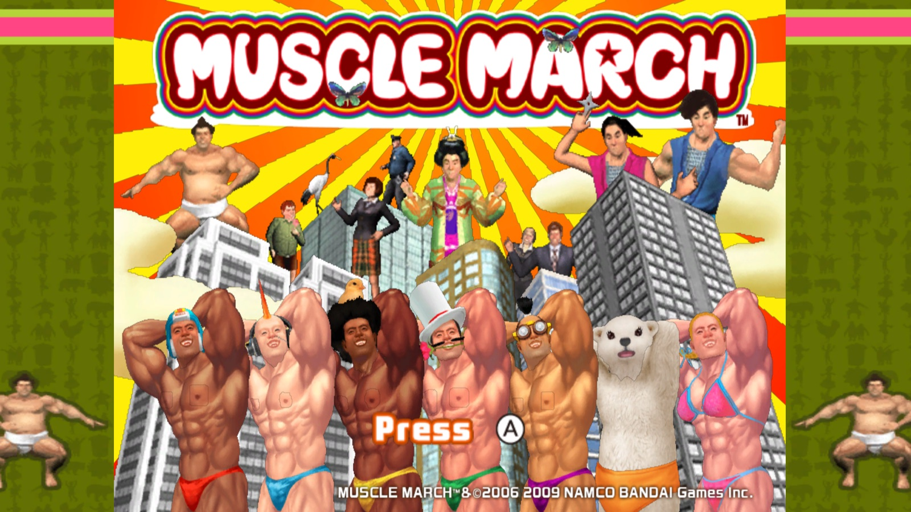
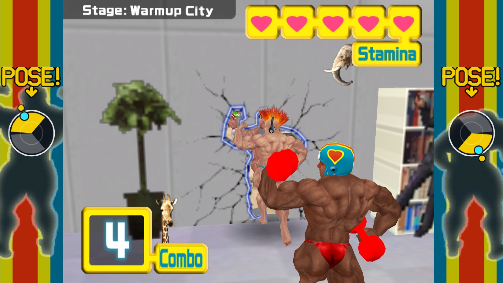
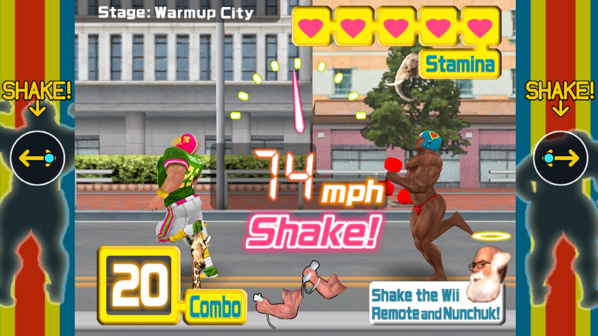
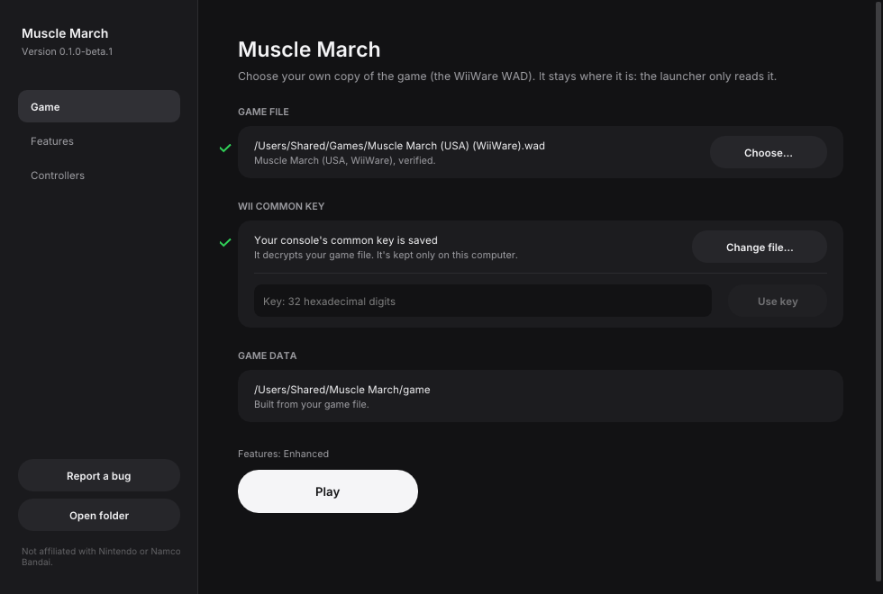
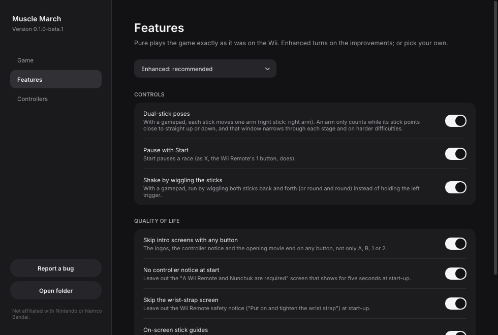
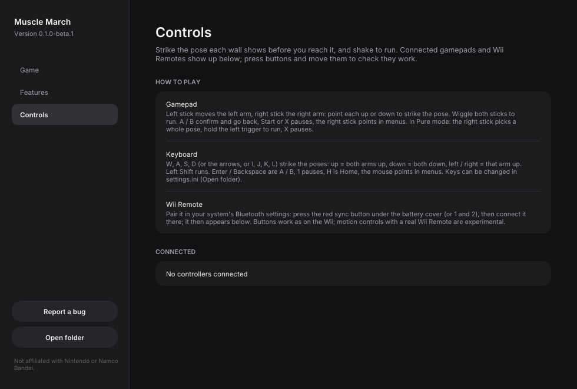
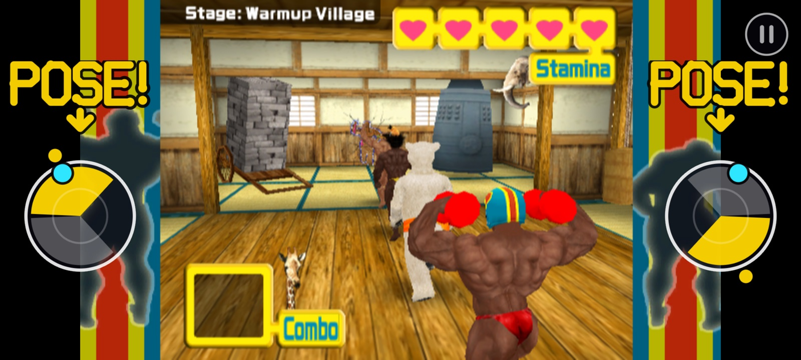

# Muscle March Recomp

An unofficial native PC port of *Muscle March* (Namco Bandai, WiiWare, 2009) for macOS, Linux,
Steam Deck and Windows, made by static recompilation.

> **Beta.** It plays the whole game, but it hasn't been tested on many machines or controllers
> yet. Expect rough edges, and please [report what you find](#feedback-and-contributing).

**No game files are included.** You need your own copy of the game (the WiiWare WAD) and your
own Wii console's common key, which the launcher uses once to decrypt it on your computer.

This project is not affiliated with, endorsed by, or sponsored by Bandai Namco Entertainment or
Nintendo. *Muscle March* is a trademark of Bandai Namco Entertainment Inc.; Wii and WiiWare are
trademarks of Nintendo.

## What it is

The game's PowerPC code is translated ahead of time into C++ and runs natively on a runtime that
stands in for the Wii's hardware: graphics on Metal, Vulkan or OpenGL, its audio, storage and
Wii Remote and Nunchuk. Nothing is emulated at the instruction level, so it runs at full speed on
modest hardware, at any resolution, with any controller.

- Plays with a gamepad, keyboard and mouse, or real Wii Remotes with a Nunchuk.
- **Pure** mode plays exactly as on the Wii. **Enhanced** mode (the default) adds the features
  below, each of which can be switched on or off in the launcher.
- Saves go in your own user folder, separate from the game file, which is only ever read.

### Enhanced features

| Feature | What it does |
| --- | --- |
| Dual-stick poses | Each stick moves one arm: point them the way the arms go. Poses are instant. The window each stick has to be in narrows as a stage goes on and on harder difficulties. |
| Shake by wiggling the sticks | Run by wiggling both sticks back and forth (or round and round). |
| On-screen stick guides | Dials in the picture's side pillars show your sticks while racing; "POSE!" and the windows to aim for appear ahead of each wall, "SHAKE!" when it's time to wiggle. |
| Touch controls | On a touch screen, the stick guides move to the sides of the screen and are the sticks: touch them to pose, rub them to run. With a pause button. |
| Pause with Start | Start pauses a race (as X, the Wii Remote's 1 button, always does). |
| Skip the wrist-strap screen | Leaves out the Wii Remote safety notice at start-up. |
| Skip intro screens | The logos, notices and opening movie end on any button. |
| No controller notice | Leaves out the "Wii Remote and Nunchuk required" screen at start-up. |

## What you need

- *Muscle March* (USA) for WiiWare, as a WAD file: `Muscle March (USA) (WiiWare).wad`
  (SHA-1 `ed99ce114d9793dbf21d5c9589d7947afebd4259`). Other releases aren't supported yet.
- Your Wii's common key: a key file from your console (for example `keys.bin` from a NAND
  backup), or the key itself as 32 hexadecimal digits. It's needed once.
- One of:
  - macOS 13 or later on Apple Silicon;
  - Linux x86_64 or SteamOS (Steam Deck);
  - Windows 10 or 11, 64-bit.
- A gamepad is recommended. Real Wii Remotes work too (pair them in your system's Bluetooth
  settings).

## Installing

Download the build for your system from the [releases page](../../releases).

### macOS

1. Unzip `MuscleMarch-macOS.zip` and move **Muscle March.app** to Applications.
2. The app isn't signed by Apple, so the first time, right-click it and choose **Open**, then
   **Open** again. (Or run `xattr -dr com.apple.quarantine "/Applications/Muscle March.app"`.)
3. In the launcher, drop your WAD on the window (or press **Choose…**), then give your key file
   or key. The launcher builds the game's files from your WAD (a few seconds).
4. Press **Play**.

### Android

1. Download `MuscleMarch-android.apk` on the phone and open it; allow your browser or file
   manager to install apps when Android asks. (arm64 phones, Android 8 or newer.)
2. Copy your WAD to the phone. On the first start, choose it, then paste or type your key, or
   choose your key file.
3. Press **Install and play**. The app builds the game's files from your WAD; later starts go
   straight to the game.

### Steam Deck

See [docs/STEAM_DECK.md](docs/STEAM_DECK.md) for the full walkthrough: install in Desktop Mode,
set up once in the launcher, then add it to Steam to play in Game Mode with the Deck's controls.

### Linux

1. Download `MuscleMarch-x86_64.AppImage` and make it executable
   (`chmod +x MuscleMarch-x86_64.AppImage`, or Properties → Permissions).
2. Run it, choose your WAD and key in the launcher, and press **Play**.

### Windows

1. Unzip `MuscleMarch-windows.zip` anywhere and run `musclemarch-launcher.exe`.
2. If Windows SmartScreen warns about an unrecognized app, choose **More info → Run anyway**
   (the builds aren't code-signed).
3. Choose your WAD and key in the launcher, and press **Play**.

Your settings, saves and the game's files built from your WAD live in your user folder:
`~/Library/Application Support/Muscle March/` (macOS), `~/.local/share/Muscle March/`
(Linux, Steam Deck) or `%APPDATA%\Muscle March\` (Windows). Delete it to start over.

## Controls

The game asks you to strike the pose shown on each wall before you reach it, and to shake the
controllers to run.

| Action | Gamepad (Enhanced) | Gamepad (Pure) | Keyboard |
| --- | --- | --- | --- |
| Poses | Left stick = left arm, right stick = right arm: point each up or down | Right stick: up = both up, down = both down, left / right = one arm up | W, A, S, D, the arrows, or I, J, K, L: up = both arms up, down = both down, left / right = that arm up |
| Run (shake) | Wiggle both sticks | Hold the left trigger | Left Shift |
| A / B | A / B | A / B | Enter / Backspace |
| Pointer (menus) | Right stick | Right stick | Mouse |
| Pause (in a race) | Start, or X / West button | X / West button (the Remote's 1) | 1 |
| HOME | Guide | Guide | H |

Keys can be changed in `settings.ini` in your user folder. F9 saves a screenshot.

On a touch screen (the Android build), the two stick guides at the sides of the screen are the
controls: touch a dial where its stick should point (the yellow window when a wall is coming), rub
or drum on both dials to run, and tap the corner button or use the back gesture to pause. In menus,
tap what you want. A connected gamepad takes over and plays as above.

## Known issues

- **Steam Deck / Linux performance** is sometimes uneven while it's smooth on macOS; we're still
  narrowing it down. If you see slowdowns, please report your device and what was on screen.
- **Windows** builds are new and lightly tested.
- The builds aren't signed or notarized, so macOS and Windows warn the first time (see Installing).
- Real Wii Remotes: buttons work, motion controls are experimental.
- Only the USA WiiWare release of the game is supported.

## Troubleshooting

- **"That key doesn't decrypt this game file."** The key must be your Wii's common key, and
  the WAD must be the USA release above.
- **The game window is black or closes at once.** Press **Report a bug** in the launcher: it opens
  a new issue with your version, system and settings filled in. Attach `logs/game.log` from your
  user folder (**Open folder** in the launcher), which holds the game's output from its last run.
- **My controller isn't detected.** The launcher's **Controls** page shows what is connected
  and lets you test every button and stick.

## Screenshots

| | |
| --- | --- |
|  |  |
|  |  |
|  |  |

## Feedback and contributing

This is a beta, and reports from real machines and controllers are the most useful thing right
now. Please [open an issue](../../issues) for bugs, crashes, glitches or ideas, with your system
and what you were doing. Contributions are welcome: see [CONTRIBUTING.md](CONTRIBUTING.md) for
how the project is built and the few rules that keep it legal (above all, never add anything
from the game itself).

Building from source: [docs/BUILDING.md](docs/BUILDING.md). How the port works:
[docs/PORT.md](docs/PORT.md), [docs/GAME.md](docs/GAME.md) and [docs/FEATURES.md](docs/FEATURES.md).

## Legal

This repository contains no code, graphics, sound or other data from *Muscle March*, and no keys.
The release downloads contain the game's program code translated into native code by the
recompiler; everything else the game needs (graphics, sound, levels) is built by the launcher from
your own copy of the game, on your machine. Please don't open issues or pull requests with game
files, keys or links to them.

The code is licensed under the [GNU GPL v3.0](LICENSE), which the recompiler and runtime it builds
on require. Third-party components and their licenses are listed in
[THIRD_PARTY_NOTICES.md](THIRD_PARTY_NOTICES.md).

## Credits

- [wiiparty-recomp](https://github.com/arelkair/wiiparty-recomp) by arelkair: the recompiler and
  runtime this port is built on.
- [Dolphin](https://dolphin-emu.org): the Nunchuk extension encryption and the AX audio
  microcode reimplementation used here, and an invaluable reference.
- [decomp-toolkit](https://github.com/encounter/decomp-toolkit), [SDL](https://libsdl.org),
  [Dear ImGui](https://github.com/ocornut/imgui), [Inter](https://rsms.me/inter/) and
  [stb](https://github.com/nothings/stb).
- Namco Bandai, for a wonderfully strange game.
