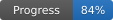

> **Vendored upstream.** This folder is [wiiparty-recomp](https://github.com/arelkair/wiiparty-recomp), which Muscle March Recomp builds on, with this project's changes listed in [`../docs/PORT.md`](../docs/PORT.md). The README below is upstream's and describes Wii Party; for Muscle March see [`../README.md`](../README.md).

# Wii Party Recomp

Static recompilation of Wii Party for native PC.

> [!NOTE]
> **Project Status:** Alpha. The game boots, reaches every menu and plays complete Board Game Island sessions and every Free Play minigame. Progress is estimated at **84%** overall.



**[Download the latest build](https://github.com/arelkair/wiiparty-recomp/releases)** · Windows 10 and 11 (64-bit) · Linux x86_64 (experimental)

---

## Overview

Wii Party Recomp translates the game's PowerPC code into C++ and compiles it into a native Windows or Linux program. The game and Nintendo SDK code run translated; only what depends on the console hardware is replaced, and the hardware itself (GPU, DSP audio, Bluetooth, IOS, disc and NAND) is reimplemented underneath. The game's own audio microcode is recompiled too.

No game files are distributed. The launcher builds the game on your PC from your own copy of the disc.

---

## Current State & Metrics

The game runs at a locked **60 fps** (PAL60) at up to 6x the console's resolution, using about 1.5 CPU threads and 200 MB of RAM.

Tracked in `games/wiiparty/analysis/progress.csv`:

| Component | Progress | Basis |
| :--- | :--- | :--- |
| **Recompilation Toolchain** | **100%** | The DOL and all 115 REL modules translate and build; every instruction kind the game uses is checked by 4,152 tests against an independent model. |
| **System Runtime** | **92%** | OS, threads, interrupts, IPC, DVD, NAND and Bluetooth work, with no known blockers. |
| **Graphics (GX to D3D11)** | **90%** | Menus, text, 3D models, lit Miis, TEV, indirect textures, fog and EFB copies; no known fault in any minigame. |
| **Audio Pipeline** | **83%** | Recompiled AX microcode; its output matches Dolphin's sample for sample on the title music. |
| **Game Flow** | **90%** | A full 17-round Board Game Island game; every Free Play minigame played by hand, all 79 without faults. |
| **Input System** | **66%** | Emulated Wii Remote over emulated Bluetooth; keyboard, mouse and up to four gamepads. |
| **PC Features** | **66%** | Single-file launcher, in-game options menu (F10), key bindings, save backups, custom textures. |

### Known Limitations

- The modes other than Board Game Island and Free Play have been tried but not played through in full.
- Real Wii Remotes are not supported yet.

---

## Installing

1. Download `wiipartyrecomp-launcher.exe` from the [releases page](https://github.com/arelkair/wiiparty-recomp/releases) (the newest one is at the top). It is the only file you need.
2. Open it, check the install folder, choose your own copy of Wii Party (`.iso`, `.wbfs`, `.rvz`, `.ciso`, `.wia` or `.gcm`) and press **Install**.
3. When it finishes, press **Play**.

The launcher downloads any missing build tools from their official sites and checks each one against its published SHA-256. Nothing from the game is downloaded and nothing leaves your computer.

**Without internet (Windows):** download `wiipartyrecomp-offline-windows.zip` from the same release instead, unzip it and open the launcher inside. It carries every build tool (about 185 MB), so the install never connects. Turn on **Offline mode** in Settings and the launcher also stops checking for updates. The source code of the GPL tools in that pack is published next to it as `wiipartyrecomp-sources.zip`.

| Requirement | |
| :--- | :--- |
| System | Windows 10 or 11, 64-bit |
| Free space | About 5 GB |
| Memory | 4 GB minimum, 8 GB or more recommended for the build |
| Build time | About 10 minutes on a 6-core processor; longer on slower machines |

### Linux (experimental)

1. Install the build tools with your package manager:
   - Debian and Ubuntu: `sudo apt install g++ cmake ninja-build python3 curl libx11-dev libxext-dev libxrandr-dev libxcursor-dev libxi-dev libxss-dev libxkbcommon-dev libwayland-dev wayland-protocols libdecor-0-dev libegl-dev libgl-dev libpulse-dev libasound2-dev libudev-dev libdbus-1-dev`
   - Fedora: `sudo dnf install gcc-c++ cmake ninja-build python3 curl libX11-devel libXext-devel libXrandr-devel libXcursor-devel libXi-devel libXScrnSaver-devel libxkbcommon-devel wayland-devel wayland-protocols-devel libdecor-devel mesa-libEGL-devel mesa-libGL-devel pulseaudio-libs-devel alsa-lib-devel systemd-devel dbus-devel`
   - Arch: `sudo pacman -S --needed gcc cmake ninja python curl sdl3`
2. Download `wiipartyrecomp-launcher-x86_64.AppImage`, make it executable (`chmod +x wiipartyrecomp-launcher-x86_64.AppImage`, or Properties > Permissions in your file manager) and open it.
3. Choose your disc and press **Install**, then **Play**. The launcher downloads only nodtool; the game is installed in `~/.local/share/WiiPartyRecomp`.

The launcher needs glibc 2.38 or newer (Ubuntu 24.04, Debian 13, Fedora 39 or later) and the game needs OpenGL 4.1. The Linux version has been tested on Ubuntu 24.04 only (under WSL); reports from other distributions, desktops and graphics cards are very welcome.

The build runs once, at low priority, with as many parallel jobs as your memory allows. Updating to a newer launcher rebuilds the game and keeps your saves and settings.

---

## Controls

Every key can be changed on the launcher's **Controls** page or in `games/wiiparty/settings.ini`. Up to four gamepads act as Wii Remotes 1 to 4, with gyroscope pointer, motion, rumble and player lights.

| Wii Remote | Keyboard and mouse |
| :--- | :--- |
| Pointer | Mouse |
| A / B | Left click, Enter or Space / Right click or Backspace |
| 1 / 2 | 1 / 2 |
| + / - / HOME | Plus / Minus / H |
| D-pad | Arrow keys, W A S D |
| Shake | Middle click or Left Shift |
| Swing up / down | Mouse wheel, T / G |
| Tilt | Q, E, R, F |
| Upright or sideways grip | Tab |

| PC key | Action |
| :--- | :--- |
| F9 | Screenshot to the `screenshots` folder |
| F10 | Options menu over the game |
| F11 | Full screen |
| F12 | Frame capture for debugging |

---

## Roadmap

| Stage | When it is reached |
| :--- | :--- |
| **Alpha** (current) | The game runs from start to finish, with known bugs and features still missing. |
| **Beta** | Every mode and all 80 minigames are checked, including the pair minigames; no known crashes; the known graphics faults in `docs/MINIGAMES.md` are fixed; the install is tested on several different PCs. |
| **1.0** | No known bugs, overall progress around 95%, and a period of use by players without serious problems. |

Also planned: a Mii editor, ultrawide support and online play.

### Platforms

- **Windows 10 and 11:** supported.
- **Linux:** experimental. The launcher is an AppImage and the game plays with an OpenGL renderer, keyboard, mouse, audio, the F10 menu and custom texture packs (tested on Ubuntu 24.04; gamepad support is built in but not yet tested there). **Help wanted:** Linux testers with different GPUs and desktops, please open an issue or a discussion.
- **macOS:** planned after Linux. **Help wanted:** if you have a Mac and would like to test builds in the future, please open an issue or a discussion.

---

## Repository Layout

```
├── engine/             # Core reusable Wii engine
├── recompiler/         # PowerPC & DSP static recompilation pipelines
├── games/wiiparty/     # Wii Party configuration and analysis
├── launcher/           # Installer and settings (SDL3 + Dear ImGui)
├── tools/              # Developer scripts
├── tests/              # Test suites
└── docs/               # Technical notes and progress
```

---

## Building from Source

Requirements: Python 3.11+, CMake 3.20+, Ninja, a MinGW-w64 GCC 13+ and [nodtool](https://github.com/encounter/nod).

```bash
nodtool extract games/wiiparty/disc/wiiparty.rvz games/wiiparty/extracted
python tools/fetch_sdl.py
python recompiler/unpack_rels.py
python recompiler/recomp.py
python recompiler/recomp_rel.py --all
python recompiler/recomp.py
python recompiler/dsp/recomp_dsp.py
cmake -S . -B build/out -G Ninja -DCMAKE_BUILD_TYPE=Release
cmake --build build/out --target wiiparty
./build/out/wiiparty
```

The launcher builds with the same compiler; CMake downloads its libraries:

```bash
cmake -S launcher -B build/launcher -G Ninja -DCMAKE_BUILD_TYPE=Release
cmake --build build/launcher
```

Technical notes and the history of every change are in `docs/DECOMP_PROGRESS.md`. See `CONTRIBUTING.md` before opening a pull request.

---

## Legal & Licensing

Independent project not affiliated with or endorsed by Nintendo. Users must supply their own legally obtained game files.

Licensed under the GPL-3.0-or-later. Third-party code and libraries are listed in `THIRD_PARTY_NOTICES.md`.
